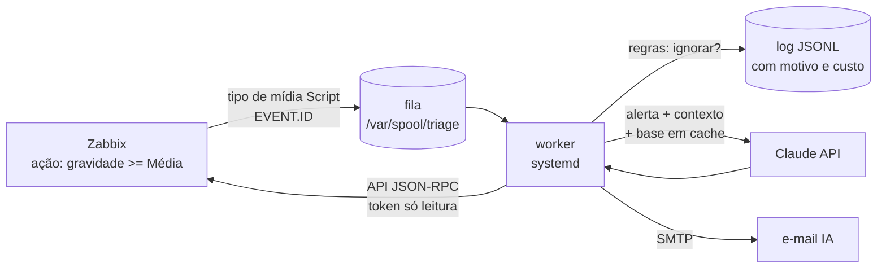

# Triagem IA para alertas do Zabbix

> **EN:** A small service that reads each Zabbix problem (severity Average+),
> gathers context from the Zabbix API and asks Claude for the 2–3 most likely
> causes and what to check first. It **only suggests, never acts**: the model
> gets no tools. Running in production in a small company's on‑prem
> environment. Blind evaluation, cost numbers and the design decisions below.

Quando um alerta do Zabbix chega às 3 da manhã, ele diz **o que** aconteceu,
mas não **por quê** nem **por onde começar**. Numa TI enxuta, sem plantão,
quem lê o alerta precisa juntar sozinho o histórico, os outros alertas do mesmo
horário e o conhecimento do ambiente.

Este serviço faz essa primeira triagem: para cada problema de gravidade
**Média ou maior**, manda um **segundo e-mail** com:

```
O QUE PROVAVELMENTE E
1. <causa mais provável> - <por quê, citando o dado>
2. <segunda causa>

O QUE CONFERIR PRIMEIRO
- <passo concreto, na ordem>

JA ACONTECEU ANTES?
- <caso parecido na base de conhecimento, ou "nada registrado">
```

O alerta normal do Zabbix continua chegando igual. Se este serviço parar, nada
se perde.

## Arquitetura



- **A ação do Zabbix só grava o ID numa fila** (um `printf` de milissegundos) e
  devolve o controle. A análise roda num serviço separado, então uma API lenta
  ou fora do ar **nunca segura o alerter do Zabbix**
- **O worker** espera a rajada assentar, aplica as regras, monta o contexto pela
  API do Zabbix (token de um usuário **só leitura**) e chama o modelo
- **Contexto enviado:** o alerta e se ele ainda está aberto, a expressão do
  gatilho, as últimas leituras dos itens, os outros problemas do host e **todos
  os eventos de outros hosts 30 min antes e 10 min depois**
- **Base de conhecimento** em Markdown (rede, servidores, problemas conhecidos,
  guia por tipo de alerta), enviada com *prompt caching*: depois da primeira
  chamada ela custa 10% do preço

## Decisões de projeto

| Decisão | Por quê |
|---|---|
| **Só sugere, nunca executa** | O modelo não recebe ferramenta nenhuma. Entra texto, sai texto. Não há como uma resposta errada mexer no ambiente |
| **Dados do alerta tratados como dados** | O conteúdo do Zabbix vai entre `<alerta>…</alerta>` e as instruções mandam ignorar qualquer pedido que apareça ali (proteção contra *prompt injection* via nome de host, item ou log) |
| **Regras antes da API** | O que não vale analisar não custa nada (ver abaixo) |
| **Hipóteses, não certezas** | As respostas usam "provável"; se faltar dado, dizem o que falta em vez de inventar |
| **Hosts críticos protegidos** | A base marca quais hosts nunca devem ter "reiniciar" como primeiro passo |
| **Teto diário e anti-repetição** | Máximo de N análises por dia; o mesmo gatilho não é reanalisado em 6 h; um host só uma vez a cada 15 min |

### O que NÃO é analisado

Medido em 30 dias reais: **76 alertas Média+ → 51 ignorados pelas regras → ~10
análises depois do agrupamento**.

| # | Regra | Exemplo |
|---|---|---|
| 1 | **Voltou sozinho** dentro da espera (Média 20 min, Alta 2 min) | serviços do antivírus que param na atualização e voltam em 4 a 15 min; portas de rede que piscam |
| 2 | **Evento de massa**: ≥ 3 hosts com problema em ±5 min | falta de energia, queda geral de rede: não há o que diagnosticar |
| 3 | **Lista de nomes** (regex no `.conf`) | nobreak, temperatura da sala: a ação é física |
| 4 | **Lista de hosts** | o próprio servidor do Zabbix (o serviço roda nele) |

Cada evento ignorado vai para o log com o motivo, para conferir depois que nada
importante passou batido. `triage.py replay --so-regras` mostra o efeito das
regras no histórico **sem chamar a API**.

## Escolha do modelo: comparação às cegas

Mesmos 15 alertas reais, 3 modelos, respostas embaralhadas como A/B/C. As notas
(*ajudou* = 2, *óbvio* = 1, *errado* = 0) foram dadas **antes** de abrir o
gabarito (`replay --modelos opus,sonnet,haiku`).

| Modelo | Pontos (de 30) | Respostas erradas | Custo por análise |
|---|---|---|---|
| **Claude Sonnet 5.5** | **26** | 0 | ~US$ 0,013 |
| Claude Opus 5.5 | 25 | 0 | ~US$ 0,029 |
| Claude Haiku 5.5 | 13 | 5 | ~US$ 0,001 |

**Escolhido: Sonnet 5.5** — mesma qualidade do Opus pela metade do preço. O
Haiku errou fatos dos próprios dados (ex.: "a porta voltou em seguida" quando o
histórico mostrava 6 min fora). Com as regras, o custo fica **abaixo de US$ 0,25
por mês**.

## O que aprendi

Os erros que apareceram nas análises **não vinham do modelo, vinham do
contexto que o programa montava**:

1. A lista de "problemas abertos" era a de **agora**, não a do momento do
   alerta → num evento antigo, o modelo achou um alerta "do futuro" e
   desconfiou do relógio
2. Os eventos vizinhos vinham de `problem.get`, que só traz o que ainda está
   aberto → num caso real, sumiam justamente a queda do túnel e o reinício do
   servidor que explicavam o alerta. Trocado por `event.get`
3. O próprio alerta ficava fora da lista de abertos → o modelo concluía
   "voltou sozinho" de um alerta que continuava aberto. Agora vai um campo
   explícito `situacao_deste_alerta`

Lição: **antes de culpar o modelo, olhe o que você mandou para ele.**

## Instalação

Requisitos: Zabbix 7.x/8.x no Linux (Ubuntu/Debian), Python 3.10+, uma chave
da [API da Anthropic](https://console.anthropic.com).

1. No Zabbix, crie um **grupo de usuários só leitura** nos grupos de hosts, um
   **usuário** nele e um **token de API** para esse usuário
2. Copie esta pasta para o servidor do Zabbix em `/tmp/triage` e rode:
   ```bash
   sudo sh /tmp/triage/install.sh
   sudo nano /etc/triage/triage.conf      # token, chave, SMTP
   ```
3. Escreva a sua `BASE-CONHECIMENTO.md` (o arquivo aqui é um exemplo
   fictício) e rode o instalador de novo
4. Teste sem gastar nada e depois com um evento real:
   ```bash
   sudo -u zabbix /opt/triage/venv/bin/python /opt/triage/triage.py analisar 0 --sem-email
   # tem de dizer "evento nao encontrado: 0" = token ok
   sudo -u zabbix /opt/triage/venv/bin/python /opt/triage/triage.py analisar <eventid> --sem-email
   ```
5. Avalie com o histórico e veja o efeito das regras:
   ```bash
   sudo -u zabbix /opt/triage/venv/bin/python /opt/triage/triage.py replay --dias 30 --so-regras --saida /tmp/regras.md
   sudo -u zabbix /opt/triage/venv/bin/python /opt/triage/triage.py replay --dias 14 --max 15 --modelos opus,sonnet,haiku --saida /tmp/teste.md
   ```
6. No Zabbix: tipo de mídia **Script** `triage-enqueue.sh` com parâmetro
   `{EVENT.ID}` (e um modelo de mensagem de problema), a mídia no usuário de
   serviço (Média + Alta + Desastre) e uma **ação** "gravidade ≥ Média →
   mensagem ao usuário de serviço só por esse tipo de mídia", sem operação de
   recuperação. Depois:
   ```bash
   sudo systemctl enable --now triage
   ```

**Desligar:** desative a ação no Zabbix. O alerta normal não depende deste
serviço.

## Testes

Todos rodam **sem rede e sem gastar crédito** (API do Zabbix e da Anthropic
simuladas):

```bash
pip install anthropic==2.5.0
for t in tests/test_*.py; do python "$t"; done
```

Cobrem: os parâmetros enviados à API (cabeçalho, cache, *fallback*, recusa,
falta de crédito), as 4 regras, o agrupamento de rajadas, a comparação às cegas
(nada do modelo vaza no arquivo de notas) e a situação do próprio alerta.

## Arquivos

| Arquivo | O quê |
|---|---|
| `triage.py` | o serviço (worker, análise avulsa, replay) |
| `triage-enqueue.sh` | chamado pelo Zabbix: grava o ID na fila |
| `triage.service` | unidade systemd, endurecida (`ProtectSystem=strict`, sem home, sem novos privilégios) |
| `install.sh` | instalação e atualização (reinicia o serviço se já estiver ligado; nunca sobrescreve o `.conf`) |
| `triage.conf.example` | configuração comentada |
| `BASE-CONHECIMENTO.md` | **exemplo fictício** de base de conhecimento |

## Autor

**Filipe Ferreira** ([@FilipeF-Dev](https://github.com/FilipeF-Dev)). Projetei,
implementei e opero esta ferramenta no ambiente de produção onde sou
responsável pela infraestrutura: desenho da arquitetura, integração com a API
do Zabbix, regras de filtragem, avaliação dos modelos e implantação.

## Licença

MIT. Veja `LICENSE`.
